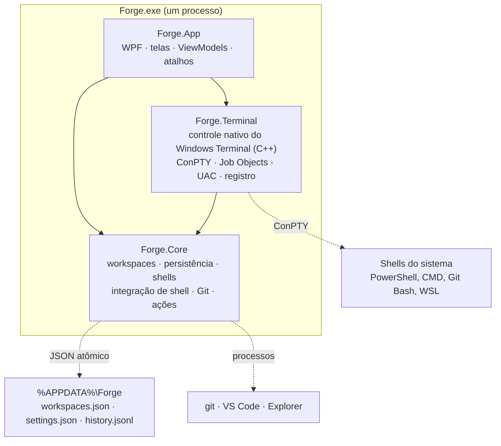

# Arquitetura do Forge

Out 23, 2026 · G3G Labs · estado: compila sem avisos e os testes passam; ainda não testado no Windows

Este documento descreve como o código do Forge está organizado: projetos, pastas, arquivos, responsabilidades e os
fluxos principais. O escopo do produto está em [Escopo-Forge.md](Escopo-Forge.md); as telas, no canvas
"Forge — Telas do MVP".

## A base: C# com o terminal nativo em C++, como o WSL Vision

O Forge segue a mesma base do WSL Vision (`Ferramentas/WSL Vision`):

- **C# 14 em .NET 10, WPF**, um único processo e um único `.exe` (edição portátil com o runtime ou edição leve que
  usa o .NET Desktop Runtime instalado).
- **Terminal nativo do Windows Terminal (C++)**: o controle `Microsoft.Terminal.Wpf` (ConPTY + renderização com
  DirectWrite), usado pelo pacote `EasyWindowsTerminalControl`. É o mesmo motor do Windows Terminal, sem navegador.
- **MVVM** com CommunityToolkit.Mvvm e controles do WPF-UI, tema escuro próprio.

Isso muda dois pontos do escopo original, de propósito:

| Escopo | Agora | Por quê |
|---|---|---|
| .NET 8 LTS | .NET 10 | Mesmo runtime do WSL Vision: um só runtime instalado para os dois apps na edição leve. |
| Parser VT e renderização próprios em C# (Fase 1, 3 semanas) | Controle nativo do Windows Terminal, em C++ | Corta o maior item de engenharia e o maior risco (vim, htop, barras do npm). O `Forge.Terminal` isola o controle: dá para trocar por um motor próprio (C# ou C++ via DLL) sem tocar no resto. |

## Camadas



A dependência é em um só sentido. O **Core não conhece WPF nem APIs só do Windows**: compila em `net10.0` e os testes
rodam em Windows, Linux ou no CI. O **Terminal** é a borda com o Windows (`net10.0-windows`). O **App** monta tudo.

## Pastas e arquivos

```
Forge/
├── Forge.sln
├── Directory.Build.props        nullable, avisos como erro, versão, empresa
├── Directory.Build.targets      ajustes do pacote do terminal nativo (igual ao WSL Vision)
├── .github/workflows/release.yml  tag vX.Y.Z → testes, .exe portátil e leve, release
├── assets/brand/                marca: forge-logo.svg (mestre), versão branca, versão pequena, PNGs de 16 a 1024 px
├── tools/gerar-logo.js          gera a marca e o app.ico a partir da geometria (Node, sem dependências)
├── docs/
│   ├── Escopo-Forge.md          o que o produto é (e não é)
│   └── ARQUITETURA.md           este documento
├── src/
│   ├── Forge.Core/              lógica pura, sem UI
│   │   ├── Models/
│   │   │   ├── Workspace.cs         WorkspaceFile, WorkspaceGroup, WorkspaceTab, WindowLayout (o workspaces.json)
│   │   │   ├── AppSettings.cs       settings.json: geral, aparência, identificação, auxílios, atalhos
│   │   │   ├── ShellProfile.cs      ShellKind, ShellFlavor, ShellProfile, ShellIds
│   │   │   ├── ColorScheme.cs       esquemas de cores; Forge Escuro e Forge Claro
│   │   │   └── History.cs           HistoryEntry (linha do history.jsonl), GitStatus
│   │   ├── Persistence/
│   │   │   ├── AppPaths.cs          %APPDATA%\Forge e os arquivos dentro dela
│   │   │   ├── ForgeJson.cs         formato JSON comum (camelCase, enums por nome)
│   │   │   ├── JsonFile.cs          escrita atômica: .tmp → flush → troca, .bak, .corrompido
│   │   │   ├── WorkspaceStore.cs    dono do workspaces.json; grava 500 ms após a última mudança
│   │   │   ├── SettingsStore.cs     dono do settings.json; só leitura na janela de administrador
│   │   │   └── HistoryStore.cs      history.jsonl: acrescentar, buscar (Ctrl+R), aparar
│   │   ├── Workspaces/
│   │   │   ├── WorkspaceEditor.cs   criar, mover, duplicar, remover grupos e abas (funções puras)
│   │   │   ├── RestorePlanner.cs    quem ganha shell ao abrir: a selecionada e as automáticas
│   │   │   └── TabStatus.cs         estado da aba (parada, rodando, erro) a partir dos eventos do shell
│   │   ├── Shells/
│   │   │   ├── ShellCatalog.cs      detecção: PowerShell 7 e 5.1, CMD, Git Bash, distros WSL, perfis
│   │   │   ├── WslListParser.cs     saída UTF-16 do wsl -l -q
│   │   │   ├── PathMapper.cs        C:\ ↔ /mnt/c ↔ \\wsl.localhost ↔ /c (Git Bash), OSC 7
│   │   │   ├── LaunchBuilder.cs     linha de comando + scripts de cada aba
│   │   │   ├── ShellScripts.cs      scripts PowerShell, bash, zsh e CMD (pasta, variáveis, auxílios, OSC 133)
│   │   │   └── LaunchPlan.cs        o resultado: comando e arquivos a gravar
│   │   ├── ShellIntegration/
│   │   │   ├── OscParser.cs         lê OSC 133/633/7 na saída, mesmo partida entre pedaços
│   │   │   └── ShellEvent.cs        PromptStarted, CommandLineReceived, CommandStarted, CommandFinished, CwdChanged
│   │   ├── Git/
│   │   │   ├── GitService.cs        git status em lote; em abas WSL, dentro da distro; cache curto
│   │   │   └── GitStatusParser.cs   git status --porcelain=v2 --branch
│   │   ├── Actions/ExternalApps.cs  VS Code (inclusive remoto no WSL), Explorer, caminho do Windows
│   │   ├── Appearance/WindowsTerminalImport.cs  importa esquemas do settings.json do Windows Terminal
│   │   ├── Processes/ProcessRunner.cs  processos de apoio (git, wsl -l, code)
│   │   └── Util/                    Debouncer, CommandLine (aspas do Windows), Ids, Palette
│   ├── Forge.Terminal/          a borda com o Windows
│   │   ├── TerminalSession.cs       um shell: o controle nativo + leitura das OSC; único arquivo que usa o pacote
│   │   ├── TerminalThemes.cs        esquema e cursor → TerminalTheme (COLORREF)
│   │   ├── Native/JobObject.cs      app num Job Object: filhos morrem com ele, nada fica órfão
│   │   ├── Native/Elevation.cs      janela de administrador pelo UAC (runas)
│   │   ├── Native/StartupRegistration.cs  iniciar com o Windows (HKCU\…\Run)
│   │   └── Shells/WindowsShellProbe.cs     registro, PATH e wsl.exe para o ShellCatalog
│   └── Forge.App/               as telas (WinExe, AssemblyName Forge)
│       ├── App.xaml(.cs)            composição: cria tudo uma vez; tema claro/escuro; erros viram aviso
│       ├── StartupArgs.cs           --admin, --add-tab, --minimized
│       ├── app.manifest             asInvoker, PerMonitorV2, caminhos longos
│       ├── Assets/                  app.ico (16 a 256 px) e logo.png, copiados de assets/brand
│       ├── Themes/                  Tokens.xaml (escuro), Tokens.Light.xaml, Styles.xaml
│       ├── Converters/Converters.cs cor hex, visibilidade
│       ├── Services/
│       │   ├── SessionManager.cs    shells abertos, um por aba iniciada; aplica tema e fonte
│       │   ├── ShortcutMap.cs       atalhos lidos antes do terminal nativo; remapeáveis
│       │   ├── SingleInstance.cs    uma janela comum e uma de administrador; repasse por pipe
│       │   ├── AdminTabPayload.cs   aba enviada da janela comum para a de administrador
│       │   └── Notifier.cs          aviso no canto ("Workspaces restaurados", erros)
│       ├── ViewModels/
│       │   ├── MainWindowViewModel.cs  árvore, seleção, restauração, ações com atalho
│       │   ├── GroupViewModel.cs       grupo: nome, cor, pasta, ambiente, recolher
│       │   ├── GroupEditorViewModel.cs criar e configurar grupo (pasta + Windows ou WSL)
│       │   ├── TabViewModel.cs         aba: shell, estado, Git, iniciar/reiniciar/parar, VS Code…
│       │   ├── TabConfigViewModel.cs   "Configurar aba" no lugar
│       │   ├── HistorySearchViewModel.cs  Ctrl+R
│       │   ├── SettingsViewModel.cs    Configurações (o único modal)
│       │   ├── AboutViewModel.cs       Sobre: Forge e G3G Labs
│       │   ├── WorkspaceContext.cs     serviços compartilhados por grupos e abas
│       │   └── IRenamable.cs
│       └── Views/
│           ├── MainWindow.xaml(.cs)    barra de título, três áreas fixas, popups
│           ├── Sidebar.xaml(.cs)       árvore, renomear no lugar, arrastar, "+", barra recolhida
│           ├── TabHeader.xaml(.cs)     nome, estado, ações e menu "…"
│           ├── GroupDialog.xaml(.cs)   criar e configurar grupo
│           ├── TabConfigPanel.xaml(.cs)
│           ├── TerminalArea.xaml(.cs)  os controles nativos; só o da aba selecionada visível
│           ├── StatusBar.xaml(.cs)     shell, pasta, branch, alterações, administrador
│           ├── HistoryPopup.xaml(.cs)  Ctrl+R
│           └── SettingsWindow.xaml(.cs)  Geral, Shells, Aparência, Terminal, Atalhos, Sobre
└── tests/Forge.Core.Tests/      xUnit, roda fora do Windows
```

## As funcionalidades do MVP no código

| Funcionalidade | Onde |
|---|---|
| Detecção de shells e perfis | `ShellCatalog`, `WindowsShellProbe`, `WslListParser`; perfis em `AppSettings.CustomProfiles` |
| Abas (criar, fechar, duplicar, arrastar, renomear, cor) | `WorkspaceEditor`, `MainWindowViewModel`, `Sidebar.xaml.cs` |
| Grupos (nome, cor, pasta, ambiente Windows ou WSL, recolher, arrastar abas entre eles) | `GroupViewModel`, `GroupEditorViewModel`, `GroupDialog.xaml`, `WorkspaceEditor` |
| Configuração da aba | `TabConfigViewModel`, `TabConfigPanel.xaml`, `LaunchBuilder` |
| Persistência e restauração | `JsonFile`, `WorkspaceStore`, `RestorePlanner`, `MainWindowViewModel.RestoreAsync` |
| Autocomplete sem maiúsculas, histórico garantido, Ctrl+R | `ShellScripts`, `OscParser`, `TabStatus`, `HistoryStore`, `HistorySearchViewModel` |
| Aparência e importação do Windows Terminal | `ColorScheme`, `WindowsTerminalImport`, `TerminalThemes`, `Tokens*.xaml` |
| Identificação no terminal | `IdentitySettings`, `ShellScripts` (prompt), `TabHeader.xaml` |
| Git | `GitService`, `GitStatusParser`, atualizado a cada comando que termina |
| Ações rápidas | `TabViewModel` (VS Code, Explorer, copiar caminho, reiniciar shell, administrador), `ExternalApps`, `Elevation` |

## Fluxos

### Abrir o app

1. `App.OnStartup`: instância única (uma comum e uma de administrador por usuário), Job Object, leitura de
   `settings.json` e `workspaces.json` (ou `workspaces-admin.json`), apara o `history.jsonl`.
2. A janela aparece na hora, com o tamanho e a posição salvos.
3. `MainWindowViewModel.InitializeAsync`: detecta os shells, monta a árvore e, na primeira vez, cria
   "Meu workspace" com uma aba no shell padrão (nenhuma configuração obrigatória).
4. `RestorePlanner`: a aba selecionada ganha shell primeiro; depois as marcadas para abrir junto com o app, uma a
   cada 150 ms. As outras ficam só na árvore, sem processo, até o clique. Aviso "Workspaces restaurados".

### Uma aba ganha shell

```mermaid
sequenceDiagram
    participant VM as TabViewModel
    participant SM as SessionManager
    participant LB as LaunchBuilder (Core)
    participant TS as TerminalSession (Terminal)
    participant Sh as Shell (ConPTY)
    VM->>SM: Start(aba, shell, pasta do grupo)
    SM->>LB: Build → linha de comando + scripts
    SM->>TS: new TerminalSession(plano, tema, fonte)
    TS->>TS: grava os scripts em %APPDATA%\Forge\shell
    TS->>Sh: controle nativo inicia o processo
    Sh-->>TS: saída (com OSC 133 invisíveis)
    TS-->>VM: ShellEvent (PromptStarted…)
    VM->>TS: digita o comando ao abrir + Enter (se houver)
    Sh-->>VM: 133;C → rodando · 133;D;código → parada ou erro
    VM->>VM: histórico unificado + Git atualizado
```

O "comando ao abrir" é opcional e escrito pelo usuário (bun dev, yarn dev…): o Forge não tem botão de iniciar ou
parar projeto. Ele não vai na linha de comando: o app o **digita** no shell quando o primeiro prompt aparece (ou, sem
integração, quando o processo responde), toda vez que o shell da aba abre. Assim roda como se o usuário digitasse, vai
para o histórico do próprio shell, e Ctrl+C para o processo sem fechar a aba.

**Grupo = projeto.** `WorkspaceGroup` guarda `Folder` e `Shell` (o ambiente: `pwsh`, `cmd`, `wsl:Ubuntu`…). Uma aba
com `Shell` e `Cwd` nulos segue o grupo (`WorkspaceEditor.ShellOf`, `LaunchBuilder.ResolveCwd`); mudar o grupo muda
todas as abas que o seguem, no próximo shell delas.

### Scripts e integração de shell

Cada aba recebe um script gerado em `%APPDATA%\Forge\shell` e recriado a cada início. Ele carrega o perfil do usuário
e só então acrescenta o do Forge. Nada é escrito nos arquivos do usuário.

| Shell | Como entra | O que o script faz |
|---|---|---|
| PowerShell 7 / 5.1 | `-NoExit -ExecutionPolicy Bypass -Command ". 'tab-<id>.ps1'"` | pasta, variáveis, PSReadLine incremental, prompt com OSC 133 e Enter que emite o texto do comando |
| bash (WSL, Git Bash) | `bash --rcfile tab-<id>.bash -i` (no WSL: `wsl.exe -d <distro> --cd ~ -- …`) | `~/.bashrc`, pasta, variáveis, `completion-ignore-case`, `history -a`, PROMPT_COMMAND e PS0 com OSC 133 |
| zsh (WSL) | `env ZDOTDIR=<pasta da aba> zsh -i` | `.zshenv` e `.zshrc` originais, `matcher-list` sem maiúsculas, `INC_APPEND_HISTORY`, hooks precmd/preexec |
| CMD | `cmd /k tab-<id>.cmd` | `chcp 65001`, pasta, variáveis. Sem integração: a aba sabe que o comando foi enviado, não quando terminou |

Sequências usadas: `OSC 133;A` (prompt), `133;C` (comando começou), `133;D;<código>` (terminou), `633;E;<texto>`
(texto do comando, com `\` e `;` escapados) e `OSC 7` (pasta atual). O `OscParser` lê sem alterar a saída.

Diferença do escopo: o autocomplete sem maiúsculas no bash usa `bind` dentro do `--rcfile` em vez de `INPUTRC` +
`WSLENV`; o efeito é o mesmo e não depende de repassar variáveis ao WSL. As variáveis da aba também vão pelo
script, pelo mesmo motivo.

### Persistência

| Arquivo | Dono | Grava quando |
|---|---|---|
| `workspaces.json` | `WorkspaceStore` (janela comum) | 500 ms depois da última mudança e ao fechar |
| `workspaces-admin.json` | `WorkspaceStore` (janela de administrador) | idem; arquivo próprio, sem disputa entre processos |
| `settings.json` | `SettingsStore` (só a janela comum) | na hora |
| `history.jsonl` | `HistoryStore` (as duas janelas acrescentam linhas) | a cada comando terminado |
| `shell\tab-<id>.*` | `TerminalSession` | a cada início de shell |

Escrita atômica (`JsonFile`): grava em `.tmp`, força o disco, troca pelo original guardando o anterior em `.bak`.
Arquivo corrompido vira `.corrompido` e o app volta para o `.bak`; arquivo bloqueado (antivírus) não é sobrescrito
sem antes guardar uma cópia `.ilegivel`. Linha truncada no `history.jsonl` é ignorada.

### Janela de administrador

O Windows não eleva uma aba dentro de uma janela comum. "Abrir como administrador" inicia `Forge.exe --admin
--add-tab <aba>` pelo UAC; a janela elevada é outra instância, marcada em amarelo, com o próprio
`workspaces-admin.json`. Se ela já estiver aberta, recebe a aba por um pipe nomeado e vem para a frente.

### Atalhos

Com o foco no terminal, as teclas vão para a janela nativa do controle e não passam pelos `KeyBinding` do WPF. O
`ShortcutMap` lê as teclas antes, em `ComponentDispatcher.ThreadPreprocessMessage`, e só age com a janela ativa e
fora de campos de texto. Padrões do escopo; remapeáveis em `settings.json` (`"shortcuts"`).

## Testes

`tests/Forge.Core.Tests` (xUnit) cobre o que dá para quebrar sem perceber:

- gravação com atraso de 500 ms, reabertura completa, arquivo truncado voltando ao `.bak`, ids repetidos;
- histórico: busca sem maiúsculas e sem repetir, filtro por pasta, linha truncada, aparar;
- `OscParser`: ciclo completo, sequência partida entre pedaços, terminador ST, escape do texto;
- `TabStatus`: erro, sucesso, Ctrl+C (130 e 0xC000013A), pronto no primeiro prompt;
- detecção de shells, `wsl -l -q` em UTF-16, conversão de pastas, OSC 7;
- `LaunchBuilder`: linhas de comando exatas, scripts, `~` fora das aspas, CMD, integração desligada, identidade;
- `RestorePlanner`, `WorkspaceEditor`, `git status`, importação do Windows Terminal.

```bash
dotnet test tests/Forge.Core.Tests
```

## Compilar e publicar

```bash
dotnet build Forge.sln
```

```bash
dotnet publish src/Forge.App -c Release
```

```bash
dotnet publish src/Forge.App -c Release -p:Edition=Lite
```

A primeira gera o `Forge.exe` portátil (inclui o .NET); a segunda, o leve (usa o .NET Desktop Runtime 10).
Uma tag `vX.Y.Z` publica as duas pelo GitHub Actions.

## Pendências e riscos

A solução compila sem erros nem avisos (que contam como erro) com o .NET SDK 10.0.402, os 59 testes do Core passam e
as duas edições do `.exe` são publicadas. O que ainda falta é abrir o app no Windows e passar pelos fluxos reais.

| Ponto | Situação |
|---|---|
| API do EasyWindowsTerminalControl | `TerminalSession` usa `ConPTYTerm` (atribuível), `TermPTY.InterceptOutputToUITerminal`, `WriteToTerm`, `CloseStdinToApp` e `StopExternalTermOnly`: tudo existe na versão 1.0.38 (compila). Falta confirmar no Windows que o intercept recebe a saída inteira, com as OSC. |
| Fim do processo do shell | O estado "Encerrada" existe em `TabStatus`, mas o aviso de que o shell saiu ainda precisa ser ligado ao evento do `TermPTY`. |
| Busca no terminal (Ctrl+Shift+F) e links clicáveis | Dependem do que o controle nativo expõe. O atalho existe e hoje mostra um aviso. |
| Conflito de atalhos | Ctrl+R e Ctrl+W são do bash (busca reversa, apagar palavra). O escopo os usa para o histórico do Forge e para fechar a aba; dá para remapear. O WSL Vision escolheu Ctrl+Shift. Vale decidir antes do beta. |
| Log em arquivo e verificação de atualização | As chaves existem nas configurações; o código que as usa ainda não. |
| Gravar atalho pela tela | A tela lista os atalhos; remapear é pelo `settings.json` por enquanto. |
| ARM64 | O publish gera `win-x64`. Para ARM64, conferir os binários nativos do pacote do terminal. |
| Perfis personalizados | Rodam o executável e os argumentos do usuário, sem script: não recebem pasta, variáveis nem integração. |
