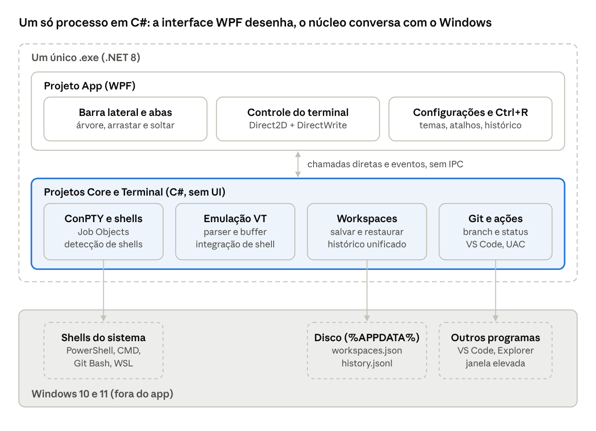
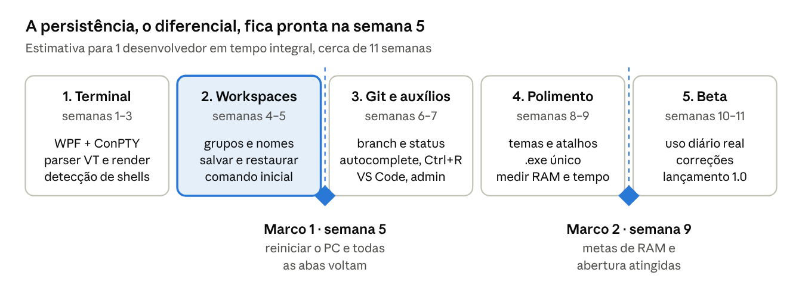

# Escopo — Terminal leve com workspaces persistentes

Oct 23, 2026 · @Gabriel Oliveira

Um terminal desktop leve para desenvolvedores, cujo diferencial é um só:
abas e grupos de terminais configurados uma vez continuam lá depois que
o PC é desligado e ligado de novo.

## Visão geral

**Problema.** Terminais como o Warp permitem agrupar abas por projeto,
renomeá-las e abrir shells diferentes (PowerShell, CMD, Git Bash, WSL).
Mas, ao reiniciar o computador, essa organização se perde e o
desenvolvedor refaz tudo: abre projeto por projeto, navega até a pasta,
renomeia abas, reagrupa e roda npm run dev em cada uma.

**Proposta.** Um terminal que faz apenas o essencial — abas, grupos,
cores, Git, ações rápidas, autocomplete e histórico — e trata a
organização como algo permanente. Ao abrir o app, os workspaces estão
prontos; um clique inicia todos os servidores de um projeto.

**O que ele não é.** Sem IA, sem conta, sem nuvem, sem motor web
embutido: um único .exe em C#, feito para o Windows. Cada recurso
precisa justificar o próprio consumo de memória.

## Objetivos e não-objetivos

O MVP é bem-sucedido se restaurar 100% das abas e grupos após um
reinício, abrir em menos de 1 segundo e consumir menos memória que os
terminais "pesados" do mercado.

**Objetivos**

- Persistir workspaces (grupos, abas, nomes, pastas, shells, comandos)
  automaticamente, sem botão "salvar".

- Abrir qualquer shell instalado na máquina: PowerShell, CMD, Git Bash e
  distros WSL.

- Auxiliar o desenvolvedor: autocomplete que ignora maiúsculas em todos
  os shells e histórico de comandos persistente e pesquisável.

- Mostrar a branch Git da pasta de cada aba.

- Oferecer ações de um clique: iniciar, reiniciar, abrir no VS Code,
  rodar como administrador.

- Entregar um único executável (.exe) nativo, com arquitetura limpa,
  consumo baixo de RAM e máxima compatibilidade com Windows 10 e 11.

**Não-objetivos**

- Recursos de IA, sugestão de comandos ou chat.

- Login, conta de usuário, sincronização em nuvem ou telemetria.

- Salvar a saída (scrollback) dos terminais.

- Substituir um editor de código ou um gerenciador de conexões SSH.

## Usuário-alvo e casos de uso

O usuário é um desenvolvedor no Windows que mantém vários projetos
ativos ao mesmo tempo, cada um com dois a cinco processos (API,
front-end, workers, banco local) rodando em shells diferentes.

1.  **Começar o dia.** Liga o PC, abre o app e vê os grupos "Cliente A",
    "Cliente B" e "Pessoal" como deixou. Clica em "Iniciar grupo" e as
    abas api, web e worker sobem com seus comandos.

2.  **Trocar de contexto.** Recolhe o grupo de um projeto e expande
    outro, sem fechar os processos em execução.

3.  **Pular para o código.** Na aba web, clica em "Abrir no VS Code" e o
    editor abre na pasta daquela aba.

4.  **Tarefa administrativa.** Abre uma aba elevada (administrador) para
    instalar uma dependência global ou mexer em serviços do Windows.

5.  **Misturar ambientes.** No mesmo grupo, uma aba em WSL (Ubuntu) roda
    o back-end e outra em PowerShell roda o front-end.

## Funcionalidades do MVP

O MVP tem dez blocos de funcionalidade; tudo que não está nesta tabela
fica para depois.

| Funcionalidade            | O que entrega                                                                                                                                                         |
|---------------------------|-----------------------------------------------------------------------------------------------------------------------------------------------------------------------|
| Detecção de shells        | Lista automaticamente PowerShell 5 e 7, CMD, Git Bash e cada distro WSL instalada (via wsl -l -q). Permite cadastrar perfis personalizados (executável + argumentos). |
| Abas                      | Criar, fechar, duplicar, reordenar arrastando e renomear com duplo clique ou F2. Cada aba pode ter uma cor.                                                           |
| Grupos (workspaces)       | Agrupar abas por projeto, com nome, cor e opção de recolher. Abas podem ser arrastadas entre grupos.                                                                  |
| Configuração da aba       | Shell, pasta inicial, comando de inicialização (ex.: npm run dev), variáveis de ambiente opcionais e chave "iniciar automaticamente".                                 |
| Persistência              | Salvamento automático de tudo acima; restauração completa ao abrir o app (detalhes na seção seguinte).                                                                |
| Auxílios ao desenvolvedor | Autocomplete insensível a maiúsculas em todos os shells, histórico garantido na seta para cima e histórico unificado pesquisável com Ctrl+R (seção a seguir).         |
| Aparência                 | Temas prontos (claro e escuro), paleta ANSI editável, fonte, tamanho, espaçamento e estilo do cursor. Importação de temas no formato do Windows Terminal.             |
| Identificação no terminal | Nome de exibição do usuário e máquina definidos pelo próprio usuário, mostrados na barra da aba e, opcionalmente, injetados no prompt de PowerShell e Bash.           |
| Git                       | Branch atual na aba e na barra de status, indicador de alterações não commitadas e contagem de commits à frente e atrás do remoto.                                    |
| Ações rápidas             | Iniciar, parar e reiniciar o comando da aba; abrir a pasta no VS Code e no Explorer; copiar caminho; abrir como administrador; iniciar ou parar o grupo inteiro.      |

Busca dentro do terminal (Ctrl+Shift+F), copiar e colar, seleção com o
mouse e links clicáveis fazem parte do componente de terminal próprio do
app.

## Auxílios ao desenvolvedor

O app garante dois comportamentos em todos os shells, inclusive WSL:
autocomplete que ignora maiúsculas e minúsculas, e histórico de comandos
que sobrevive ao reinício e é pesquisável entre abas.

| Auxílio                              | Como funciona                                                                                                                                                                                                                                                                                                                                     | Shells                     |
|--------------------------------------|---------------------------------------------------------------------------------------------------------------------------------------------------------------------------------------------------------------------------------------------------------------------------------------------------------------------------------------------------|----------------------------|
| Autocomplete insensível a maiúsculas | Ao iniciar o shell, o app injeta set completion-ignore-case on (readline) por meio de um arquivo gerado por ele, apontado pela variável INPUTRC (repassada ao WSL via WSLENV), que inclui o ~/.inputrc original. Para zsh, o equivalente via zstyle matcher-list. Nada é gravado nos arquivos do usuário. PowerShell e CMD já ignoram maiúsculas. | bash e zsh (WSL, Git Bash) |
| Histórico com seta para cima         | O shell continua dono do histórico (PSReadLine, .bash_history). O app só garante que ele seja gravado a cada comando (history -a + histappend no bash) e que o PSReadLine esteja carregado, para que nada se perca ao fechar a aba.                                                                                                               | todos                      |
| Histórico unificado do app           | Cada comando executado é registrado com data, aba e pasta, usando integração de shell (sequências OSC 133). Ctrl+R abre uma busca por texto em todas as abas; Enter cola o comando na aba atual.                                                                                                                                                  | todos                      |
| Sugestões inline (pós-MVP)           | Painel discreto abaixo do cursor com caminhos, comandos recentes da mesma pasta e scripts do package.json.                                                                                                                                                                                                                                        | todos                      |

A integração de shell é um script pequeno por shell (PowerShell, bash,
zsh), injetado na inicialização e desligável nas configurações.

## Persistência de sessão

O app salva a estrutura dos workspaces e o histórico de comandos, não a
saída dos terminais: ao reabrir, cada aba volta com nome, pasta e shell,
e só executa seu comando se estiver marcada para iniciar
automaticamente.

| Item                                                 | Salvo?   | Observação                                                                                                 |
|------------------------------------------------------|----------|------------------------------------------------------------------------------------------------------------|
| Grupos: nome, cor, ordem, recolhido ou não           | Sim      | Base da restauração.                                                                                       |
| Abas: nome, cor, ordem, grupo                        | Sim      | Base da restauração.                                                                                       |
| Shell, pasta inicial, variáveis de ambiente          | Sim      | Configurados pelo usuário.                                                                                 |
| Comando de inicialização e "iniciar automaticamente" | Sim      | Executado ao restaurar ou pelo botão "Iniciar".                                                            |
| Última pasta visitada na aba                         | Opcional | Desligado por padrão; a aba volta à pasta inicial.                                                         |
| Janela: tamanho, posição, aba ativa                  | Sim      | Restaura o layout exato.                                                                                   |
| Tema e preferências                                  | Sim      | Arquivo separado dos workspaces.                                                                           |
| Histórico de comandos do shell                       | Sim      | Gravado pelo próprio shell a cada comando (PSReadLine, .bash_history); o app só garante que isso aconteça. |
| Histórico unificado do app                           | Sim      | history.jsonl, um comando por linha com data, aba e pasta; limite configurável (padrão 50 mil linhas).     |
| Saída do terminal (scrollback)                       | Não      | Reduz disco e memória.                                                                                     |
| Log em arquivo                                       | Opcional | Desligado por padrão; quando ligado, um arquivo por aba com rotação a cada 5 MB.                           |
| Processos em execução                                | Não      | Não é possível "congelar" um processo; ele é reiniciado pelo comando salvo.                                |

**Como salvar.** Toda alteração dispara um salvamento com atraso de 500
ms (agrupa mudanças rápidas), e o app também salva ao fechar. A escrita
é atômica: grava em arquivo temporário e renomeia, mantendo uma cópia do
último arquivo válido. Assim, desligar o PC no meio de uma gravação não
corrompe os workspaces.

**Onde salvar.** %APPDATA%\\nome-do-app\>\workspaces.json e
settings.json e history.jsonl, em JSON legível para permitir edição
manual e versionamento.

{  
"version": 1,  
"groups": \[  
{  
"id": "g1",  
"name": "Cliente A",  
"color": "#4F8EF7",  
"collapsed": false,  
"tabs": \[  
{  
"id": "t1",  
"name": "api",  
"shell": "wsl:Ubuntu",  
"cwd": "/home/dev/cliente-a/api",  
"startup": "npm run dev",  
"autostart": true  
},  
{  
"id": "t2",  
"name": "web",  
"shell": "pwsh",  
"cwd": "C:\\dev\\cliente-a\\web",  
"startup": "npm run dev",  
"autostart": false  
}  
\]  
}  
\]  
}

**Restauração.** Ao abrir, o app recria todas as abas imediatamente, mas
só inicia o shell da aba visível e das abas com "iniciar
automaticamente"; as demais iniciam quando forem abertas. Isso mantém a
abertura rápida mesmo com dezenas de abas. Opcionalmente, o app pode
iniciar junto com o Windows.

## UI/UX

A interface tem três áreas fixas — barra lateral de grupos, terminal e
barra de status — e nenhuma configuração obrigatória antes do primeiro
uso.

**Layout**

- **Barra lateral (esquerda, recolhível):** árvore de grupos e abas, com
  bolinha de status por aba (parada, rodando, erro) e a branch Git ao
  lado do nome. Botões "Iniciar grupo" e "Parar grupo" aparecem ao
  passar o mouse no grupo.

- **Cabeçalho da aba:** nome editável e ícones de iniciar, reiniciar,
  parar, VS Code, Explorer e menu "…" (duplicar, copiar caminho, abrir
  como administrador, configurar).

- **Terminal:** ocupa todo o espaço restante, sem bordas ou painéis
  extras.

- **Barra de status (inferior, 24 px):** shell, pasta atual, branch,
  alterações pendentes e se a aba é administrador.

**Princípios**

- Tudo se edita no lugar (inline): renomear, trocar cor, mudar comando.
  Modais só para configurações globais.

- Criar uma aba nova leva no máximo dois cliques: "+" e escolher o
  shell; a pasta sugerida é a do grupo.

- Cores com propósito: a cor do grupo marca suas abas, vermelho só para
  erro, amarelo para abas administrador.

- Todo ícone tem dica (tooltip) e atalho de teclado.

**Atalhos padrão**

| Ação                               | Atalho                    |
|------------------------------------|---------------------------|
| Nova aba no grupo atual            | Ctrl+T                    |
| Novo grupo                         | Ctrl+Shift+G              |
| Fechar aba                         | Ctrl+W                    |
| Renomear aba                       | F2                        |
| Próxima / anterior                 | Ctrl+Tab / Ctrl+Shift+Tab |
| Ir para aba 1–9                    | Ctrl+1 … Ctrl+9           |
| Iniciar / reiniciar comando da aba | Ctrl+Shift+R              |
| Buscar no histórico unificado      | Ctrl+R                    |
| Abrir pasta no VS Code             | Ctrl+Shift+E              |
| Buscar no terminal                 | Ctrl+Shift+F              |
| Configurações                      | Ctrl+,                    |

Todos os atalhos podem ser remapeados em settings.json.

## Arquitetura e stack

A recomendação é C# com .NET 8 (LTS) e WPF, em um único processo e um
único .exe, com o terminal renderizado via DirectWrite; C++ com Win32 e
Direct2D fica como plano B se as metas de memória e abertura não
fecharem ao fim da Fase 1.

| Camada                   | Escolha                                                                      | Por quê                                                                                             |
|--------------------------|------------------------------------------------------------------------------|-----------------------------------------------------------------------------------------------------|
| Linguagem e runtime      | C# 12 em .NET 8 LTS                                                          | Produtividade alta, acesso direto às APIs Win32 por P/Invoke, suporte de longo prazo.               |
| Interface                | WPF                                                                          | Nativo e maduro no Windows 10 e 11; árvore, abas, arrastar e soltar e temas prontos, sem motor web. |
| Renderização do terminal | Controle próprio desenhando com Direct2D e DirectWrite (via Vortice.Windows) | Texto na GPU com latência baixa; mesma técnica do Windows Terminal.                                 |
| Emulação de terminal     | Parser e buffer próprios seguindo a máquina de estados VT (padrão xterm)     | Não há biblioteca madura em C#; é o maior item de engenharia e fica na Fase 1.                      |
| Pseudoterminal           | ConPTY (CreatePseudoConsole) via P/Invoke                                    | API oficial do Windows desde a versão 1809; funciona com qualquer shell.                            |
| Processos                | Job Objects                                                                  | Shells e filhos encerram junto com a aba; nada fica órfão.                                          |
| Shells                   | PowerShell, CMD, Git Bash e wsl.exe -d \<distro\>                            | Detecção pelo Registro, PATH e wsl -l -q.                                                           |
| Git                      | .git/HEAD com FileSystemWatcher; git status --porcelain sob demanda          | Sem biblioteca Git embutida; em pastas WSL, roda dentro da distro.                                  |
| Persistência             | System.Text.Json, escrita atômica                                            | Sem banco de dados, sem dependências extras.                                                        |
| Empacotamento            | dotnet publish single-file                                                   | Um .exe assinado; opcional autocontido (inclui o runtime) ou dependente do .NET instalado.          |

**Organização do código.** Três projetos na solução, com dependência só
de cima para baixo: App (WPF, telas e comandos), Core (workspaces,
histórico, Git, ações, sem nenhuma referência a UI) e Terminal (emulação
VT, ConPTY e renderização). Core e Terminal têm testes automatizados; o
parser VT é testado contra a suíte de sequências do xterm.

arquitetura · interface, núcleo e sistema

Tudo roda em um processo: a interface chama o núcleo diretamente, sem
IPC, sem WebView e sem Node, e só o núcleo conversa com o Windows e
grava em disco.

**Por que não C++ desde o início.** C++ com Win32 e Direct2D dá o menor
consumo e o menor executável (é a base do Windows Terminal), mas a
interface — árvore de grupos, arrastar e soltar, telas de configuração —
custa duas a três vezes mais tempo. Como App não conhece a implementação
do terminal, o projeto Terminal pode ser reescrito em C++ depois,
exposto ao C# por uma DLL, sem tocar no resto.

**Alternativas descartadas.** Electron, Tauri e qualquer solução com
WebView2 saem por exigirem um motor web, contrariando a meta de leveza.
WinUI 3 depende do Windows App SDK e complica o .exe único. Avalonia
funciona, mas é uma camada a mais sobre o Windows sem ganho para um app
só Windows.

## Requisitos não-funcionais

As metas abaixo são o "contrato de leveza" do produto; uma versão que
estoure qualquer uma delas não é lançada.

| Métrica                                       | Meta                   | Como medir                                                     |
|-----------------------------------------------|------------------------|----------------------------------------------------------------|
| RAM do app com 10 abas abertas                | \< 150 MB              | Gerenciador de Tarefas, processo do app, sem contar os shells  |
| Abertura a frio até a primeira aba utilizável | \< 1 s                 | Cronômetro do app no log de inicialização                      |
| Restauração de 20 abas em 5 grupos            | \< 2 s                 | Mesmo cronômetro                                               |
| CPU com todas as abas ociosas                 | \< 1%                  | Monitor de desempenho por 60 s                                 |
| Latência de digitação                         | \< 16 ms               | Ferramenta de medição de input lag                             |
| Saída intensa (ex.: cat de 100 MB)            | sem travar a interface | Teste automatizado com cronômetro                              |
| Entrega                                       | um único .exe          | Dependente do .NET: \< 5 MB; autocontido com runtime: \< 80 MB |

**Compatibilidade.** Windows 10 (versão 1809 ou mais nova, exigida pelo
ConPTY) e Windows 11, x64 e ARM64; nenhuma dependência além do .NET 8
(ou nenhuma, na versão autocontida). Testado com PowerShell 5.1 e 7,
CMD, Git Bash e WSL 1 e 2.

**Qualidade de código.** Três projetos com dependência em um só sentido
(App → Core → Terminal), testes automatizados em Core e Terminal,
análise estática (nullable habilitado, analisadores do .NET como erro) e
nenhum async void ou acesso à UI fora do thread principal.

**Plataforma.** Windows 10 (versão 1809 ou mais nova, exigida pelo
ConPTY) e Windows 11 no MVP; só Windows, por decisão: a stack (WPF,
ConPTY) é nativa do sistema.

**Privacidade.** Funciona totalmente offline, sem telemetria e sem
chamadas de rede, exceto a verificação de atualização, que pode ser
desligada.

## Fora do escopo e versões futuras

Fica permanentemente fora: IA, contas e sincronização em nuvem, motor
web embutido e sistema de plugins. Os itens abaixo são candidatos para
depois do MVP, em ordem de valor estimado.

1.  **Arquivo de workspace no projeto.** Um .workspace.json versionado
    no repositório, que qualquer pessoa da equipe importa com um clique.

2.  **Sugestão de comandos.** Ler os scripts do package.json (e
    similares) da pasta e oferecê-los como comando de inicialização.

3.  **Divisão de tela.** Duas ou mais abas lado a lado dentro da mesma
    área.

4.  **Alertas de processo.** Notificação quando o comando de uma aba
    termina com erro ou cai.

5.  **Portas em uso.** Mostrar na aba a porta que o servidor abriu (ex.:
    :3000) com link para o navegador.

6.  **Painéis divididos com entrada sincronizada. Digitar uma vez e
    enviar para várias abas do grupo**.

## Roadmap

O MVP leva cerca de 11 semanas para um desenvolvedor em tempo integral;
a Fase 1 é a mais longa porque a emulação de terminal é escrita do zero,
e a persistência de workspaces fica pronta na semana 5.

roadmap · 5 fases, 2 marcos

Cada fase termina com uma versão utilizável. A partir do Marco 1, o app
já pode substituir o fluxo atual no dia a dia, mesmo sem Git,
autocomplete e temas.

## Riscos, decisões e critérios de aceite

O maior risco técnico é a aba de administrador: o Windows não permite
elevar um processo filho dentro de uma janela não elevada.

| Risco                                 | Impacto                                                                                     | Mitigação                                                                                                              |
|---------------------------------------|---------------------------------------------------------------------------------------------|------------------------------------------------------------------------------------------------------------------------|
| Elevação de administrador (UAC)       | Aba admin não pode viver na mesma janela comum                                              | Abrir uma segunda janela elevada do app só com as abas admin, marcada em amarelo                                       |
| Emulação VT própria em C#             | Maior item de engenharia; bugs aparecem em apps como vim, htop e barras de progresso do npm | Seguir a máquina de estados VT do xterm, testes contra sua suíte de sequências e teste manual com esses apps na Fase 1 |
| Desempenho da renderização            | Saída intensa pode travar a interface                                                       | Parser em thread próprio, repintura limitada a 60 fps, Direct2D em vez de controles WPF por caractere                  |
| Injeção de configuração nos shells    | Pode conflitar com .bashrc ou perfis do usuário                                             | Injetar só por variáveis de ambiente e arquivos do app; opção de desligar por shell                                    |
| Git em pastas do WSL                  | Ler \\wsl\$ a partir do Windows é lento                                                     | Para abas WSL, consultar a branch rodando git dentro da distro, com cache                                              |
| Processos órfãos ao fechar            | Servidores continuam rodando em segundo plano                                               | Associar cada shell a um Job Object do Windows, encerrado junto com a aba                                              |
| Comandos interativos na inicialização | Comando trava esperando resposta                                                            | Aba mostra o terminal normalmente; o usuário responde                                                                  |

**Decisões em aberto**

- Nome do produto.

- Entrega padrão: .exe dependente do .NET (pequeno) ou autocontido (sem
  instalar nada).

- Restaurar na última pasta visitada ou sempre na pasta inicial
  configurada.

- Log em arquivo entra no MVP ou fica para depois.

- Reescrever o projeto Terminal em C++ só se as metas não fecharem, ou
  já planejar isso.

**Critérios de aceite do MVP**

- [ ] Criar 3 grupos com 3 abas cada, em shells diferentes, renomear
  tudo, reiniciar o PC e encontrar tudo igual.

- [ ] "Iniciar grupo" sobe todos os comandos do grupo de uma vez.

- [ ] A branch Git aparece e muda sozinha ao trocar de branch no
  terminal.

- [ ] No WSL, cd doc + Tab completa Documentos; a seta para cima mostra
  comandos de antes do reinício.

- [ ] vim, htop e npm install renderizam corretamente.

- [ ] "Abrir no VS Code" abre a pasta correta, inclusive em abas WSL.

- [ ] Aba de administrador abre após confirmação do UAC.

- [ ] Desligar o PC durante uma gravação não corrompe os workspaces.

- [ ] Todas as metas da seção de requisitos não-funcionais são
  atingidas.
